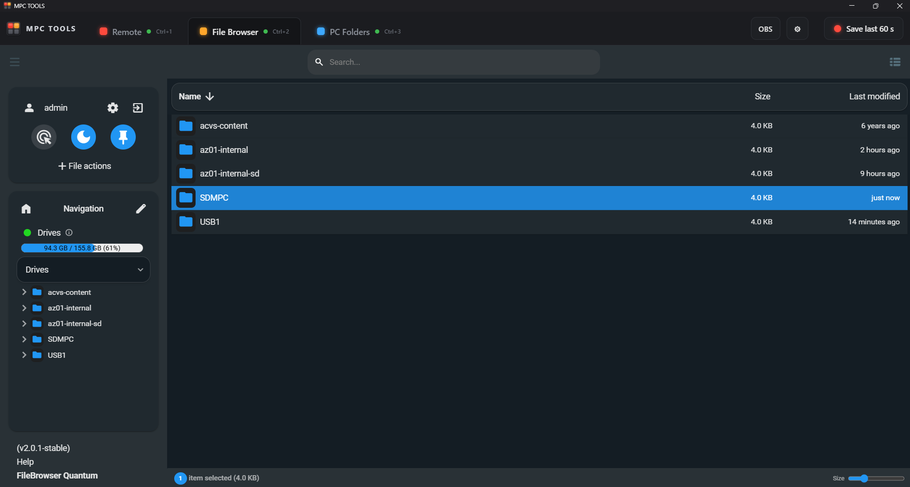
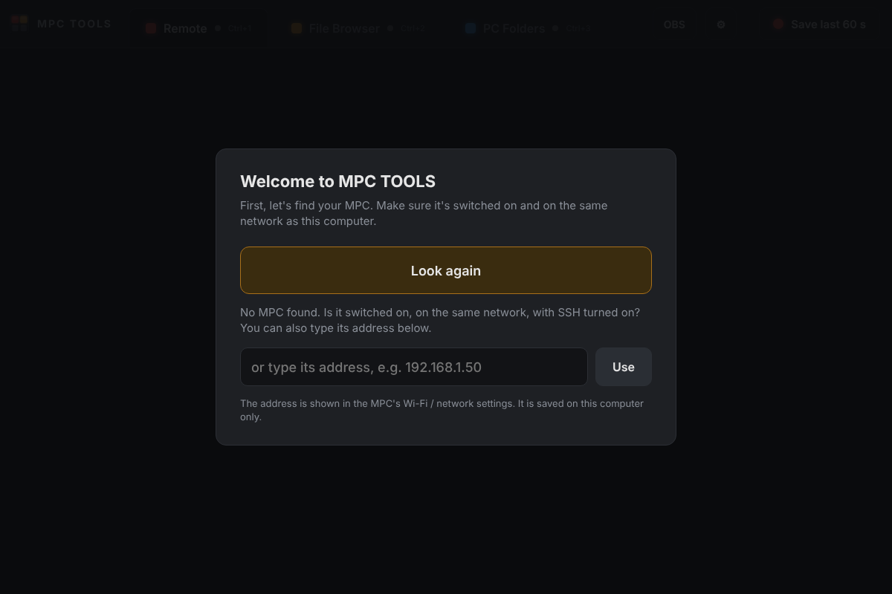
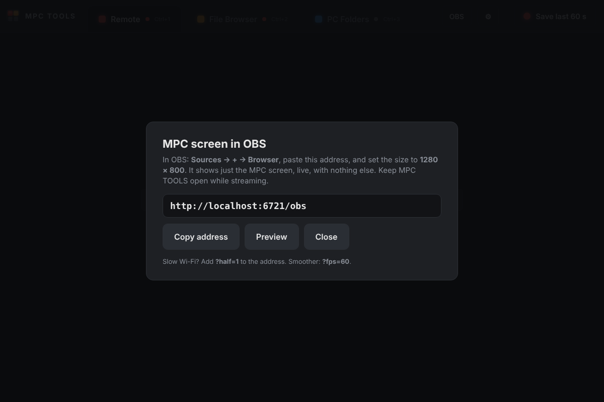

# MPC TOOLS

**A second-screen dashboard for your Akai MPC.** One small Windows app with everything you want on the screen next to your MPC:

- 🖥️ **Remote**: your MPC's screen live on your PC. Click to touch it, with Start / Play / Stop / Rec buttons.
- 🎥 **OBS**: send the MPC screen into OBS with one link, for streaming or recording tutorials.
- 📁 **File Browser**: drag files between your PC and the MPC's drives.
- 🗂️ **PC Folders**: your PC's folders appear *inside the MPC's own browser*, with no copying (MPC Link built in).
- ⏺️ **Save last 60 s**: jamming and something good just happened? One click saves the last minute of the MPC's output as a WAV.
- 🎛️ **Plugins**: the PotentialSuite plugins on your MPC. See which version each is on, **update them all** in one tap, **restart the MPC app**, **test** them (CPU bench and load test) and **record** the result on GitHub, make a **new version**, and set the **folders** PotentialBreaks and PotentialWax look in.

One click to open, nothing to type. Made by **PotentialBreaks** for my own setup, and shared free.



---

## Download

Get **`MPC-TOOLS-<version>-windows-x64.exe`** from [**Releases**](../../releases). It's a single file with nothing to install: put it on your Desktop and double-click it.

The first time, Windows may say **"Windows protected your PC"**, because the app isn't signed (signing costs money). Click **More info → Run anyway**. The full source code is here, and every release is built from it by GitHub (see [How releases are made](#how-releases-are-made)).

### Mac (new in 1.4.1, not yet tested on a real Mac)

Get **`MPC-TOOLS-<version>-mac.zip`** from [**Releases**](../../releases), double-click it, and drag **MPC TOOLS** into **Applications**. It runs on Apple Silicon and Intel Macs (macOS 11 or newer).

The first time, macOS will say it **can't check the app for malware**, because it isn't notarised by Apple (that costs money). Click **Done**, then open **System Settings → Privacy & Security**, scroll down and click **Open Anyway**. You only do this once.

The Mac already has SSH. The window opens in Brave, Chrome or Edge if you have one, otherwise in Safari. If something doesn't work on your Mac, please [open an issue](../../issues).

---

## What you need

MPC TOOLS is a dashboard: it connects to small helper programs ("addins") that run on the MPC. Each tab needs its own addin. **You only need the ones for the tabs you want.** A tab without its addin just says "isn't connected".

### On your PC

| What | Why it's needed | How to get it |
|---|---|---|
| **Windows 10 or 11 (64-bit)**, or a **Mac** (macOS 11+) | MPC TOOLS runs on these | – |
| **OpenSSH Client** | Every connection to the MPC goes through SSH, a secure connection | Built into Windows 10/11. If it's missing: **Settings → System → Optional features → Add a feature → OpenSSH Client**. [Microsoft's guide](https://learn.microsoft.com/windows-server/administration/openssh/openssh_install_firstuse) |
| **Brave, Chrome or Edge** | The app shows its window using one of these browsers (in "app mode", so it looks like a normal window) | Edge is already in Windows. If you have Brave or Chrome, MPC TOOLS uses those first |
| **OBS Studio** *(optional)* | Only for streaming or recording the MPC screen | [obsproject.com](https://obsproject.com/) |

### On your MPC

| What | Which tab uses it | Why it's needed | How to get it |
|---|---|---|---|
| **SSH access as root, without a password prompt** | All | MPC TOOLS connects in the background, so it can't stop to ask for a password | MPCs running HAKAI firmware or set up with [Open MPC](https://open-mpc.github.io/) usually allow this. If yours asks for a password, see [SSH key setup](#ssh-key-setup) |
| **[MPC Remote addin](https://github.com/jacob-sabella/mpc-addin-remote)** by Jacob Sabella | Remote, OBS | Captures the MPC's screen and touch, and sends Play / Stop / Rec | Follow its README, or use the **Addins** tab of the [MPC Plugin Installer](https://open-mpc.github.io/) if it's listed there. **HAKAI users:** see [the HAKAI note](#hakai-firmware-note) |
| **[MPC File Browser addin](https://github.com/jacob-sabella/mpc-addin-filebrowser)** by Jacob Sabella | File Browser | A web file manager running on the MPC | Follow its README. Log in with the username and password it gives (change them after) |
| **[MPC Skipback addin](https://github.com/sd88me/mpc-addin-skipback)** by sd88me | Save last 60 s | Always keeps the last minute of the MPC's output, ready to save | Follow its README, or the [MPC Plugin Installer](https://open-mpc.github.io/)'s Addins tab |
| *Nothing to install* | PC Folders | [MPC Link](https://github.com/padbangers/mpc-link) by Padbangers is **built into** MPC TOOLS. The first time, it copies one small program (`sshfs`) to the MPC by itself | – |

---

## First run

1. Switch the MPC on, and wait until the MPC app has fully started.
2. Double-click **MPC TOOLS**. The welcome screen looks for your MPC on your network. Tap it when it appears. If it isn't found, type the MPC's address (shown in the MPC's Wi-Fi / network settings) and tap **Use**.
3. That's it. The tabs connect by themselves, and next time it opens straight away.

| Welcome screen | OBS button |
|---|---|
|  |  |

**Change MPC:** use the **⚙** button. **Shortcuts:** Ctrl+1/2/3 switch tabs, and **Ctrl+S** saves the last 60 seconds.

### PC Folders (MPC Link)

Open the **PC Folders** tab, click **Add folder…** and pick a folder on your PC: a picker opens right inside the tab, with big **Back / Up a level / Start** buttons, then **✓ Use this folder**. It then shows up in the MPC's own browser, on the SD card or USB drive, in a folder with your PC's name. It connects whenever MPC TOOLS is open, and is removed from the MPC when you close it.

Already use the separate MPC Link app? Close it first (right-click its icon by the clock → Quit). MPC TOOLS uses the same settings, so your folders carry over.

### MPC screen in OBS

Click **OBS** in MPC TOOLS for the link (`http://localhost:6721/obs`). In OBS: **Sources → + → Browser**, paste the link and set the size to **1280 × 800**. You get just the MPC screen, live, with no buttons or borders. Keep MPC TOOLS open while you stream. On slow Wi-Fi, add `?half=1` to the link.

---

## Things to know (limitations)

- **Windows only**, for now.
- **Tested on one MPC:** an MPC One running HAKAI 3.10. Other standalone MPCs should work if their addins do, but I haven't tried them. [Tell me](../../issues/new/choose) how it goes on yours.
- **Rec and Overdub don't light up** on the Remote tab, because the MPC doesn't report them. Play and Stop do. ([Reported upstream](https://github.com/jacob-sabella/mpc-addin-remote/issues).)
- **No MPC One hardware buttons in Remote.** Pressing the MPC One's own buttons from the PC isn't possible with the current Remote addin. The on-screen Start / Play / Stop / Rec buttons work.
- **PC Folders only shows while your PC is on** and MPC TOOLS is open. It's a live link, not a copy.
- **Not alongside the separate MPC Link app.** If MPC Link is running, the PC Folders tab steps aside.
- **Unsigned app**, so expect the Windows warning described above.

---

## Privacy

Everything stays between your PC and your MPC. MPC TOOLS has no accounts, no tracking and no internet connection of its own. Your MPC's address is saved in `%AppData%\MPC TOOLS\settings.ini`, and MPC Link's folder list in `%AppData%\MPC Link\config.json`. Its pages only listen on your own computer (`localhost`), so nobody else on your network can use them.

---

## Firmware with "user access" (November 2026)

The inMusic firmware with the built-in **user access** mode (remote screen and SSH) starts the MPC app the standard way, so addins installed on the MPC aren't loaded any more. Symptom: the Remote tab can't connect and **Save last 60 s** says Skipback isn't loaded, while the File Browser still works.

MPC TOOLS 1.3.0 loads them for you. If you open it within a few minutes of switching the MPC on, it does it by itself. Later, the Remote tab shows a **Load add-ons** button instead, because loading them restarts the MPC app (save your project first). Nothing on the MPC is changed for good: the fix lives in the MPC's memory, so switching the MPC off and on always starts it normally again.

## The Plugins tab (1.4.0)

Everything for the PotentialSuite plugins, with no PowerShell lines to paste:

- **The list** shows each plugin's version on the MPC and the newest on GitHub, marked **UP TO DATE** or **UPDATE**.
- **UPDATE ALL** downloads the newest version of every plugin and puts it in **VST2 Plugins** on your MPC. Old copies are moved to a `Potential-backup-<date>` folder, not deleted. Each row also has its own **UPDATE**.
- **RESTART MPC APP** so the new versions load (save your project first).
- **TEST** runs Open MPC's CPU bench on each plugin on the MPC (a Gen1 MPC such as the MPC One). It also loads and runs each plugin, so it doubles as a load test. The results show on the page and go to `Potential-bench.txt` on your Desktop.
- **RECORD ON GITHUB** (after TEST, once you've played them): each plugin's GitHub page gets a "works on" entry and its CPU figure.
- **NEW VERSION** (on each row): GitHub bumps the version, writes the release notes (yours, or the changes since the last release), and builds and publishes it. About five minutes later UPDATE ALL installs it.
- **Plugin folders**: the folders PotentialBreaks and PotentialWax look in, and where SAVE KIT saves. Pick them from the MPC's drives, tap **SAVE TO MPC**, then RESCAN in each plugin. The lists are kept on your PC too, so SAVE TO MPC puts them back after an MPC reset.

RECORD ON GITHUB and NEW VERSION need MPC TOOLS connected to GitHub once: tap **GitHub** on the tab and follow the four steps (a fine-grained token with **Actions: Read and write**). The token is kept in MPC TOOLS' settings on your PC only. The same two jobs are buttons on each plugin's GitHub page too (Actions → **New version** / **Mark tested** → Run workflow).

### Add anyone's plugin (1.5.0)

The Plugins tab isn't only for the PotentialSuite. Tap **+ ADD A PLUGIN**, copy the plugin's GitHub page address and tap **PASTE**. It joins the list, and then:

- **UPDATE / UPDATE ALL** install its newest release into `VST2 Plugins`, the same way as the PotentialSuite (old copies go to a backup folder).
- **TEST** benches it on a Gen1 MPC.
- **REMOVE** takes it off the list. The plugin stays on the MPC.

NEW VERSION and RECORD ON GITHUB stay for the PotentialSuite repos, which have the workflows for them.

**For plugin makers:** MPC TOOLS reads your newest GitHub release. It needs a `.zip` with one `<Maker> - VST - <Name>` folder at the top (the folder that goes in `VST2 Plugins`), with a `plugin.json` holding `"version"` (and `"file32"` for TEST). If you have more than one zip, name them with `armhf` / `armv7` (Gen1) or `aarch64` / `arm64` (Gen2) and MPC TOOLS picks the one for the MPC. Zips with `source`, `windows` or `mac` in the name are skipped.

Plugins packaged for the **Open MPC Plugin Manager** (a zip with a `payload` folder, like Crate Digger) put files in several places on the MPC, so MPC TOOLS shows their versions but leaves installing and updating to the Plugin Manager.

## Update the Potential plugins with one paste (older way)

On MPC OS 3.10.1 or later, paste this into PowerShell to put the newest versions of all seven Potential plugins into **VST2 Plugins** on your MPC. Old copies (including any in the old **Synths** folders) are moved into a `Potential-backup-<date>` folder, not deleted. It asks before restarting the MPC app, so save your project first.
```
irm https://raw.githubusercontent.com/PotentialBreakfast/mpc-tools/main/scripts/update-potential-plugins.ps1 | iex
```

## HAKAI firmware note

On HAKAI, MPC addins can fail to load, because HAKAI's start-up script replaces the setting addins use to load (`LD_PRELOAD`). Symptom: the Remote tab says the connection was refused. The workaround is described in [this MPC Remote issue](https://github.com/jacob-sabella/mpc-addin-remote/issues).

## SSH key setup

Only needed if `ssh root@<your-mpc-address>` asks you for a password. MPC TOOLS can't type passwords for you, so it needs an **SSH key** instead: a pair of files that lets your PC log in securely without one.

- **The easy way:** the [MPC Plugin Installer](https://open-mpc.github.io/) can create a key and set it up on the MPC for you.
- **By hand:** run `ssh-keygen -t ed25519` in PowerShell (press Enter at each question), then add the contents of `%USERPROFILE%\.ssh\id_ed25519.pub` to the MPC's `/root/.ssh/authorized_keys`. Some firmware keeps this file somewhere else, so check your firmware's notes.

Afterwards, `ssh root@<your-mpc-address>` should log straight in, and MPC TOOLS will too.

---

## Ideas, bugs and criticism

All welcome, and short messages are great. [💡 Suggest an idea](../../issues/new?template=idea.yml) · [🐛 Report a bug](../../issues/new?template=bug.yml). See [CONTRIBUTING.md](CONTRIBUTING.md).

More from me, free plugins for the MPC: **[PotentialBreaks](https://github.com/PotentialBreakfast/mpc-vst-potentialbreaks)** (drum-break slicer) and **[PotentialPatina](https://github.com/PotentialBreakfast/mpc-vst-potentialpatina)** (retro-colour effect).

## How releases are made

Each release is built from this source by GitHub Actions (`.github/workflows/release.yml`), so the download matches the code. To build it yourself: install [Go](https://go.dev/dl/) 1.24 or newer, then:
```
GOOS=windows GOARCH=amd64 go build -trimpath -ldflags "-H=windowsgui -s -w" -o "MPC TOOLS.exe" .
```

## Credits

- **[MPC Link](https://github.com/padbangers/mpc-link)** by Padbangers (MIT): built in as the PC Folders tab, under `linkcore/`, with its look and credit kept. MPC TOOLS adds a folder picker inside the page, because the Windows folder window could open behind other windows.
- **[mpc-addin-remote](https://github.com/jacob-sabella/mpc-addin-remote)** and **[mpc-addin-filebrowser](https://github.com/jacob-sabella/mpc-addin-filebrowser)** by Jacob Sabella, and **[mpc-addin-skipback](https://github.com/sd88me/mpc-addin-skipback)** by sd88me: the addins MPC TOOLS talks to.
- **[Open MPC](https://open-mpc.github.io/)**, the community that makes all of this possible.
- Made with help from Claude (Anthropic).

Not affiliated with or endorsed by Akai Professional or inMusic. MPC is their trademark.

## Licence

[MIT](LICENSE). Third-party parts keep their own licences: see [THIRD_PARTY.md](THIRD_PARTY.md).
