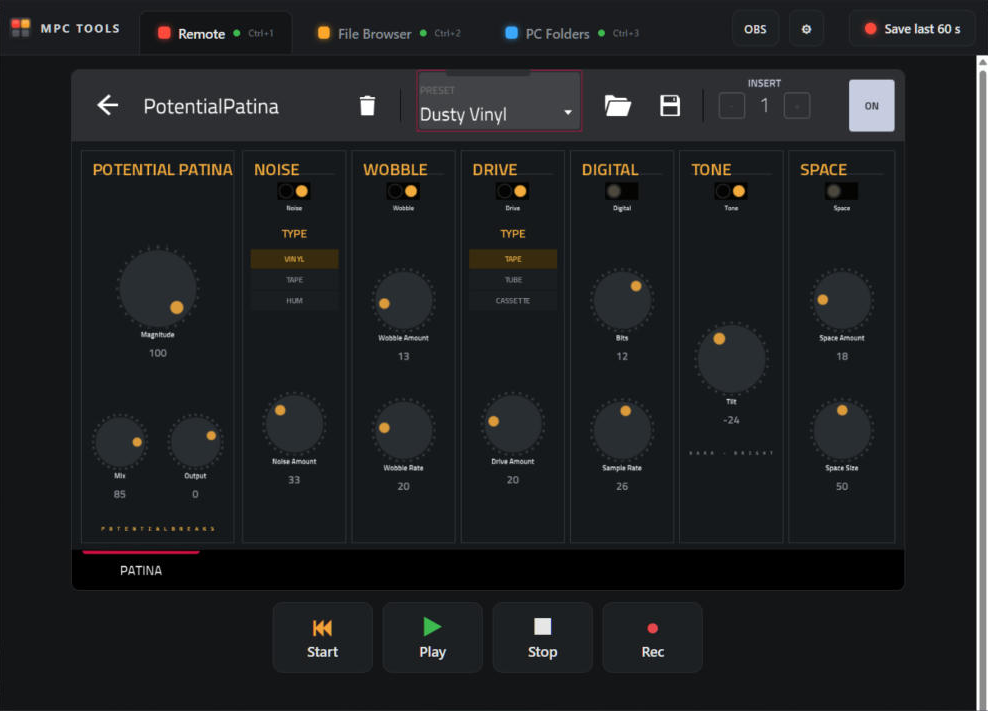

# MPC TOOLS

**A second-screen dashboard for your Akai MPC.** One small Windows app with everything you want on the screen next to your MPC:

- 🖥️ **Remote**: your MPC's screen live on your PC. Click to touch it, with Start / Play / Stop / Rec buttons.
- 🎥 **OBS**: send the MPC screen into OBS with one link, for streaming or recording tutorials.
- 📁 **File Browser**: drag files between your PC and the MPC's drives.
- 🗂️ **PC Folders**: your PC's folders appear *inside the MPC's own browser*, with no copying (MPC Link built in).
- ⏺️ **Save last 60 s**: jamming and something good just happened? One click saves the last minute of the MPC's output as a WAV.

One click to open, nothing to type. Made by **PotentialBreaks** for my own setup, and shared free.



---

## Download

Get **`MPC-TOOLS-<version>-windows-x64.exe`** from [**Releases**](../../releases). It's a single file with nothing to install: put it on your Desktop and double-click it.

The first time, Windows may say **"Windows protected your PC"**, because the app isn't signed (signing costs money). Click **More info → Run anyway**. The full source code is here, and every release is built from it by GitHub (see [How releases are made](#how-releases-are-made)).

---

## What you need

MPC TOOLS is a dashboard: it connects to small helper programs ("addins") that run on the MPC. Each tab needs its own addin. **You only need the ones for the tabs you want.** A tab without its addin just says "isn't connected".

### On your PC

| What | Why it's needed | How to get it |
|---|---|---|
| **Windows 10 or 11 (64-bit)** | MPC TOOLS is a Windows app | – |
| **OpenSSH Client** | Every connection to the MPC goes through SSH, a secure connection | Built into Windows 10/11. If it's missing: **Settings → System → Optional features → Add a feature → OpenSSH Client**. [Microsoft's guide](https://learn.microsoft.com/windows-server/administration/openssh/openssh_install_firstuse) |
| **Brave, Chrome or Edge** | The app shows its window using one of these browsers (in "app mode", so it looks like a normal window) | Edge is already in Windows. If you have Brave or Chrome, MPC TOOLS uses those first |
| **OBS Studio** *(optional)* | Only for streaming or recording the MPC screen | [obsproject.com](https://obsproject.com/) |

### On your MPC

| What | Which tab uses it | Why it's needed | How to get it |
|---|---|---|---|
| **SSH access as root, without a password prompt** | All | MPC TOOLS connects in the background, so it can't stop to ask for a password | MPCs running HAKAI firmware or set up with [Open MPC](https://open-mpc.github.io/) usually allow this. If yours asks for a password, see [SSH key setup](#ssh-key-setup) |
| **[MPC Remote addin](https://github.com/jacob-sabella/mpc-addin-remote)** by Jacob Sabella | Remote, OBS | Captures the MPC's screen and touch, and sends Play / Stop / Rec | Follow its README, or use the **Addins** tab of the [MPC Plugin Installer](https://open-mpc.github.io/) if it's listed there. **HAKAI users:** see [the HAKAI note](#hakai-firmware-note) |
| **[MPC File Browser addin](https://github.com/jacob-sabella/mpc-addin-filebrowser)** by Jacob Sabella | File Browser | A web file manager running on the MPC | Follow its README. Log in with the username and password it gives (change them after) |
| **[MPC Skipback addin](https://github.com/sd88me/mpc-addin-skipback)** by sd88me | Save last 60 s | Always keeps the last minute of the MPC's output, ready to save | Follow its README, or the [MPC Plugin Installer](https://open-mpc.github.io/)'s Addins tab |
| *Nothing to install* | PC Folders | [MPC Link](https://github.com/padbangers/mpc-link) by Padbangers is **built into** MPC TOOLS. The first time, it copies one small program (`sshfs`) to the MPC by itself | – |

---

## First run

1. Switch the MPC on, and wait until the MPC app has fully started.
2. Double-click **MPC TOOLS**. The welcome screen looks for your MPC on your network. Tap it when it appears. If it isn't found, type the MPC's address (shown in the MPC's Wi-Fi / network settings) and tap **Use**.
3. That's it. The tabs connect by themselves, and next time it opens straight away.

| Welcome screen | OBS button |
|---|---|
|  |  |

**Change MPC:** use the **⚙** button. **Shortcuts:** Ctrl+1/2/3 switch tabs, and **Ctrl+S** saves the last 60 seconds.

### PC Folders (MPC Link)

Open the **PC Folders** tab, click **Add folder…** and pick a folder on your PC. It then shows up in the MPC's own browser, on the SD card or USB drive, in a folder with your PC's name. It connects whenever MPC TOOLS is open, and is removed from the MPC when you close it.

Already use the separate MPC Link app? Close it first (right-click its icon by the clock → Quit). MPC TOOLS uses the same settings, so your folders carry over.

### MPC screen in OBS

Click **OBS** in MPC TOOLS for the link (`http://localhost:6721/obs`). In OBS: **Sources → + → Browser**, paste the link and set the size to **1280 × 800**. You get just the MPC screen, live, with no buttons or borders. Keep MPC TOOLS open while you stream. On slow Wi-Fi, add `?half=1` to the link.

---

## Things to know (limitations)

- **Windows only**, for now.
- **Tested on one MPC:** an MPC One running HAKAI 3.10. Other standalone MPCs should work if their addins do, but I haven't tried them. [Tell me](../../issues/new/choose) how it goes on yours.
- **Rec and Overdub don't light up** on the Remote tab, because the MPC doesn't report them. Play and Stop do. ([Reported upstream](https://github.com/jacob-sabella/mpc-addin-remote/issues).)
- **No MPC One hardware buttons in Remote.** Pressing the MPC One's own buttons from the PC isn't possible with the current Remote addin. The on-screen Start / Play / Stop / Rec buttons work.
- **PC Folders only shows while your PC is on** and MPC TOOLS is open. It's a live link, not a copy.
- **Not alongside the separate MPC Link app.** If MPC Link is running, the PC Folders tab steps aside.
- **Unsigned app**, so expect the Windows warning described above.

---

## Privacy

Everything stays between your PC and your MPC. MPC TOOLS has no accounts, no tracking and no internet connection of its own. Your MPC's address is saved in `%AppData%\MPC TOOLS\settings.ini`, and MPC Link's folder list in `%AppData%\MPC Link\config.json`. Its pages only listen on your own computer (`localhost`), so nobody else on your network can use them.

---

## HAKAI firmware note

On HAKAI, MPC addins can fail to load, because HAKAI's start-up script replaces the setting addins use to load (`LD_PRELOAD`). Symptom: the Remote tab says the connection was refused. The workaround is described in [this MPC Remote issue](https://github.com/jacob-sabella/mpc-addin-remote/issues).

## SSH key setup

Only needed if `ssh root@<your-mpc-address>` asks you for a password. MPC TOOLS can't type passwords for you, so it needs an **SSH key** instead: a pair of files that lets your PC log in securely without one.

- **The easy way:** the [MPC Plugin Installer](https://open-mpc.github.io/) can create a key and set it up on the MPC for you.
- **By hand:** run `ssh-keygen -t ed25519` in PowerShell (press Enter at each question), then add the contents of `%USERPROFILE%\.ssh\id_ed25519.pub` to the MPC's `/root/.ssh/authorized_keys`. Some firmware keeps this file somewhere else, so check your firmware's notes.

Afterwards, `ssh root@<your-mpc-address>` should log straight in, and MPC TOOLS will too.

---

## Ideas, bugs and criticism

All welcome, and short messages are great. [💡 Suggest an idea](../../issues/new?template=idea.yml) · [🐛 Report a bug](../../issues/new?template=bug.yml). See [CONTRIBUTING.md](CONTRIBUTING.md).

More from me: **[Potential Plugins](https://github.com/PotentialBreakfast/potential-plugins)**, free plugins for the MPC (PotentialBreaks, PotentialPatina…).

## How releases are made

Each release is built from this source by GitHub Actions (`.github/workflows/release.yml`), so the download matches the code. To build it yourself: install [Go](https://go.dev/dl/) 1.24 or newer, then:
```
GOOS=windows GOARCH=amd64 go build -trimpath -ldflags "-H=windowsgui -s -w" -o "MPC TOOLS.exe" .
```

## Credits

- **[MPC Link](https://github.com/padbangers/mpc-link)** by Padbangers (MIT): built in as the PC Folders tab, under `linkcore/`, with its look and credit kept. It also fixes the folder picker opening behind other windows.
- **[mpc-addin-remote](https://github.com/jacob-sabella/mpc-addin-remote)** and **[mpc-addin-filebrowser](https://github.com/jacob-sabella/mpc-addin-filebrowser)** by Jacob Sabella, and **[mpc-addin-skipback](https://github.com/sd88me/mpc-addin-skipback)** by sd88me: the addins MPC TOOLS talks to.
- **[Open MPC](https://open-mpc.github.io/)**, the community that makes all of this possible.
- Made with help from Claude (Anthropic).

Not affiliated with or endorsed by Akai Professional or inMusic. MPC is their trademark.

## Licence

[MIT](LICENSE). Third-party parts keep their own licences: see [THIRD_PARTY.md](THIRD_PARTY.md).
